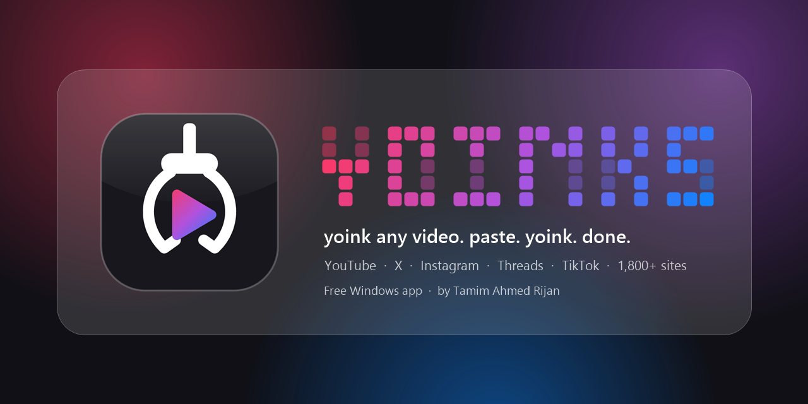
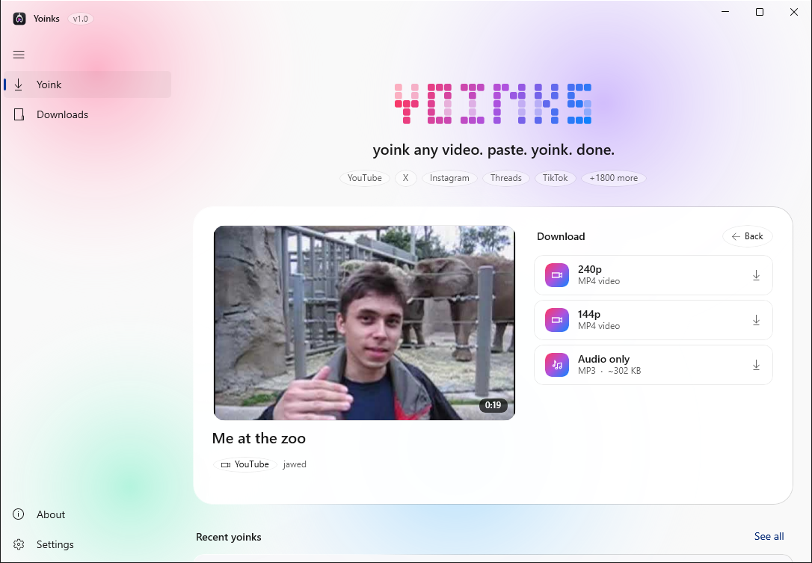
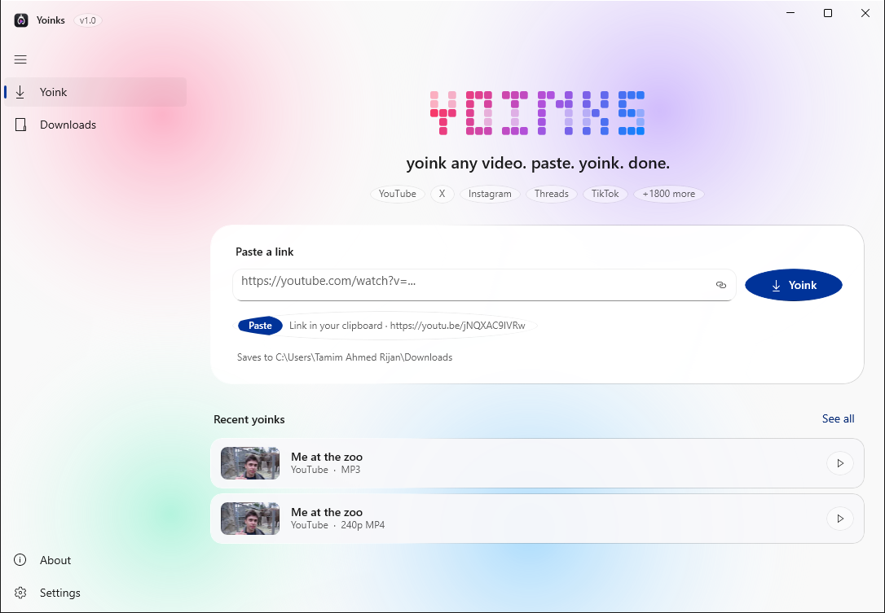
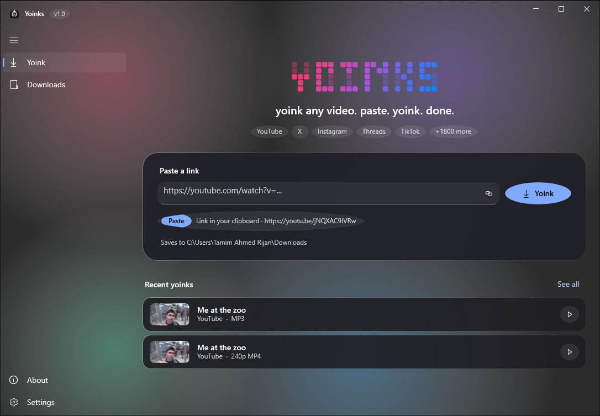
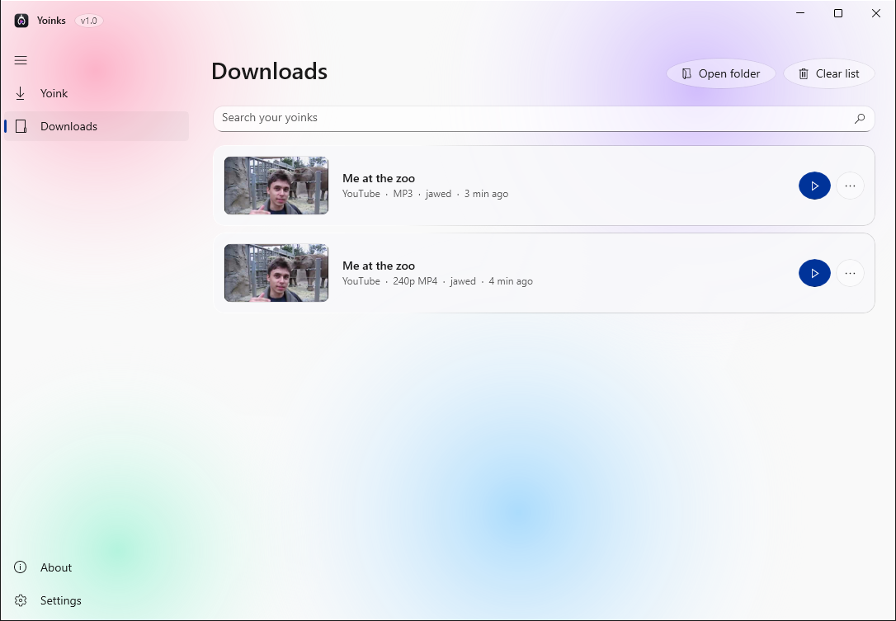
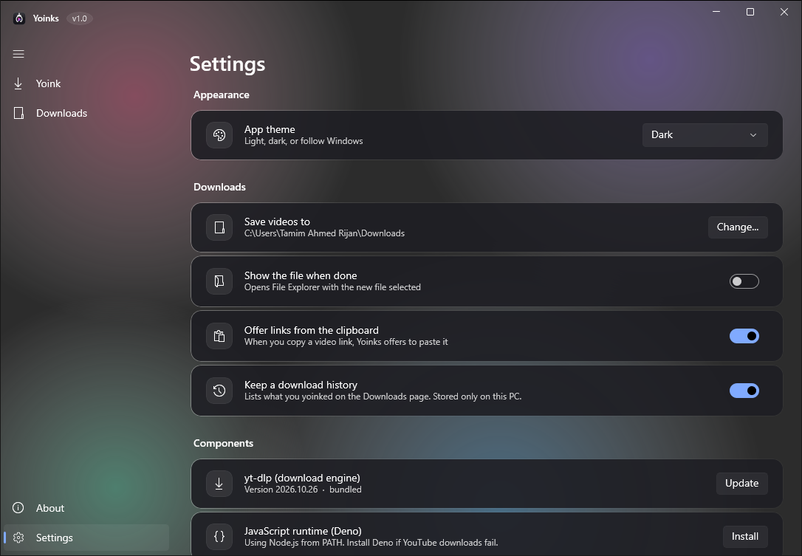
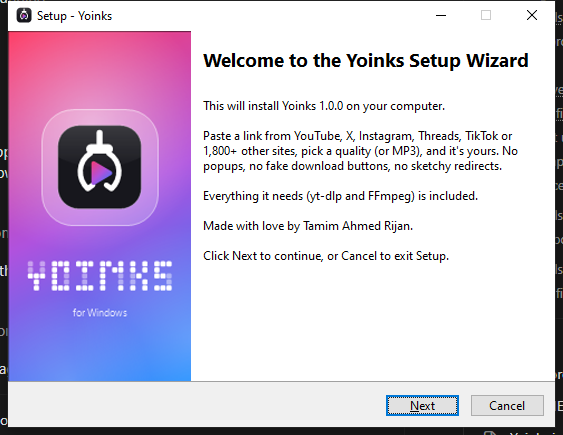

<div align="center">



<br />

### Paste a link. Pick a quality. **It's yours.**
A native Windows app for downloading videos from YouTube, X, Instagram, Threads, TikTok and 1,800+ other sites.
No popups, no fake download buttons, no sketchy redirects.

<br />

[](https://github.com/tamimrijan/yoinks-windows/releases/latest)

<br />

[](https://github.com/tamimrijan/yoinks-windows/releases)
[](https://github.com/tamimrijan/yoinks-windows/releases)
[](#-requirements)
[](https://dotnet.microsoft.com/)
[](LICENSE)
[](https://github.com/tamimrijan/yoinks-windows/stargazers)

[**Features**](#-features) · [**Install**](#-install) · [**FAQ**](#-faq) · [**Build it yourself**](#%EF%B8%8F-build-from-source) · [**Author**](#-author)

</div>

<br />

<div align="center">
<picture>
  <source media="(prefers-color-scheme: dark)" srcset="docs/screenshots/pick-dark.png" />
  
</picture>
</div>

<br />

## 🎬 What is this?

[yoinks](https://github.com/pablostanley/yoinks) by Pablo Stanley is a lovely little video downloader for the
terminal. **Yoinks for Windows** takes the same idea and the same engine ([yt-dlp](https://github.com/yt-dlp/yt-dlp))
and turns it into a real desktop app: a proper window, a setup wizard, an uninstaller, and a Windows 11 look.

Copy a link, open Yoinks, it offers to paste it. Pick 1080p, 720p or MP3. Done.

## ✨ Features

| | |
| --- | --- |
| 📋 **Paste and go** | Copy a video link and Yoinks offers to paste it for you |
| 🎚️ **Pick your quality** | Every resolution the site offers, with estimated file sizes, or audio-only MP3 |
| 📈 **Live progress** | Speed, time left, part 1 of 2 for HD merges, plus progress on the taskbar button |
| 🗂️ **Downloads page** | Search everything you've yoinked, play it, show it in Explorer, yoink it again |
| 🔖 **"Yoink this" bookmark** | One click on any video page in your browser sends it straight to Yoinks |
| 🪟 **Windows 11 look** | Fluent design, Mica, frosted iOS-style glass, light and dark mode |
| 🔧 **Fixes itself** | Sites change; update yt-dlp from Settings with one click |
| 📦 **Batteries included** | yt-dlp and FFmpeg ship with the installer, nothing else to set up |

<table>
  <tr>
    <td width="50%"></td>
    <td width="50%"></td>
  </tr>
  <tr>
    <td></td>
    <td></td>
  </tr>
</table>

## 📥 Install

1. Download **Yoinks-Setup-x.y.z-x64.exe** from the [latest release](https://github.com/tamimrijan/yoinks-windows/releases/latest)
2. Run it. If SmartScreen shows up, click **More info → Run anyway** (the app isn't code-signed)
3. Follow the wizard:
   - install just for you (no admin needed) or for everyone
   - choose where your videos are saved (Downloads by default)
   - pick a desktop shortcut, Deno for full YouTube quality, and browser links

<div align="center">

</div>

### Uninstall

**Settings → Apps → Installed apps → Yoinks → Uninstall.** It closes Yoinks and removes the app, its shortcuts,
the `yoinks:` link handler and its components. It asks before removing your settings and history.
**The videos you downloaded are never touched.**

## 🔖 The "Yoink this" bookmark

In Yoinks, go to **Settings → Browser → Copy bookmark**. Add a new bookmark in your browser and paste it as the URL.
Now on any video page, click the bookmark and the video opens in Yoinks, ready to pick a quality.
(Needs the "Let your browser send links to Yoinks" option in the installer, which is on by default.)

## ❓ FAQ

**YouTube only shows low resolutions.**
YouTube now needs a JavaScript runtime for its full list of formats. Tick "Download Deno" in the installer,
or go to **Settings → Components → JavaScript runtime → Install**.

**A site that used to work stopped working.**
Sites change all the time. **Settings → Components → yt-dlp → Update** grabs the newest yt-dlp.

**It says the site needs me to log in.**
Some videos are private or behind a login. Yoinks only downloads what's publicly viewable.

**Where are my settings stored?**
`%LOCALAPPDATA%\Yoinks` (settings, history, updated components). The app itself is in
`%LOCALAPPDATA%\Programs\Yoinks` or `C:\Program Files\Yoinks`.

**Why is the installer 130 MB?**
Most of it is FFmpeg, which merges HD video with its audio and converts to MP3. Shipping it means it works the moment it's installed.

## 💻 Requirements

- Windows 10 (1809 or newer) or Windows 11, 64-bit
- An internet connection (it's a downloader, after all)

Mica needs Windows 11; on Windows 10 you get acrylic glass instead.

## 🛠️ Build from source

You need the [.NET 8 SDK](https://dotnet.microsoft.com/download/dotnet/8.0) and [Inno Setup 6](https://jrsoftware.org/isinfo.php).

```powershell
powershell -ExecutionPolicy Bypass -File .\build.ps1 -Version 1.0.0
```

The first run downloads yt-dlp and FFmpeg into `vendor\` (cached for later builds).
Output: `dist\app` (the app) and `dist\Yoinks-Setup-<version>-x64.exe` (the installer).
Add `-SkipInstaller` to only build the app.

| Path | What's in it |
| --- | --- |
| `src/Yoinks` | The WinUI 3 app (C#, .NET 8, Windows App SDK) |
| `src/Yoinks/Services/YtDlp.cs` | Probing, format choices and downloading, ported from yoinks' `ytdlp.ts` |
| `installer/Yoinks.iss` | The Inno Setup script: wizard pages, Deno download, uninstall |
| `tools/make-art.ps1` | Draws the app icon and installer artwork |
| `tools/make-banner.ps1` | Draws `docs/banner.png` |

## 👤 Author

<table>
  <tr>
    <td></td>
    <td>
      <b>Tamim Ahmed Rijan</b><br />
      <a href="https://github.com/tamimrijan">GitHub</a> ·
      <a href="https://www.instagram.com/tamim_ahmed_rijan/">Instagram</a>
    </td>
  </tr>
</table>

## 🙏 Credits

- [yoinks](https://github.com/pablostanley/yoinks) by Pablo Stanley (MIT), the original terminal app and the pixel wordmark
- [yt-dlp](https://github.com/yt-dlp/yt-dlp) (Unlicense), the download engine
- [FFmpeg](https://ffmpeg.org) (GPL v3), merging and MP3 conversion
- [Deno](https://deno.com) (MIT), YouTube's JavaScript challenges

## ⚖️ Fair use

Yoinks is a personal-archiving tool. Downloading content may break a platform's terms of service.
Only download what you have the right to keep, and be excellent to creators.

## 📄 License

[MIT](LICENSE). Bundled components keep their own licenses (see above).
